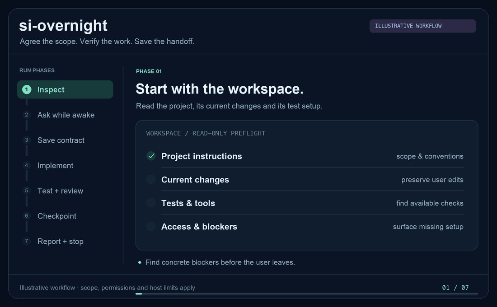

# si-overnight

**English** · [Türkçe](https://github.com/siguelabs/si/blob/main/README.tr.md)

Give your coding agent a clear plan before you sleep. `si-overnight` helps it
finish agreed work, test the changes, save checkpoints, and leave a morning report.

It is a portable [Agent Skill](https://agentskills.io/), with installers for
Codex, Claude Code, Google Antigravity, and pi. The skill supplies the workflow;
your agent host supplies the tools, permissions, and execution time.



*Illustrative workflow diagram, not a recording of an agent session. Parallel
workers are optional and require host support.*

[Quick start](#quick-start) · [How it works](#how-it-works) ·
[Hosts and paths](#hosts-and-installation-paths) · [Resume](#resume-a-run) ·
[Development](#development-and-contributing)

## Quick start

Use the source checkout today. The Node.js installer requires **Node.js 20+**,
has no package dependencies, and does not require Python.

```bash
git clone https://github.com/siguelabs/si.git
cd si
node bin/si-overnight.mjs --platform codex --project /absolute/path/to/project
```

If you already have this repository, run the `node bin/si-overnight.mjs ...`
command from its root. Choose `claude`, `antigravity`, or `pi` for another host,
or `all` for every supported host. The target project directory must already
exist. Open that project in your host and invoke the skill with its command below.

For example, in Codex:

```text
$si-overnight
Tonight, fix the checkout bugs in issues #12 and #18.
Ask me for the remaining decisions before I leave.
Work for at most six hours from the start of this run.
```

Replace the tasks and deadline with your own. The agent inspects the project and
collects the missing decisions before implementation starts. A bare invocation
starts intake; it does not authorize an unspecified night of changes.

### npm installation

Install the latest published release:

```bash
npx --yes si-overnight --platform all --project /absolute/path/to/project
npx --yes si-overnight --platform codex --scope user
```

To try the current package without a registry release, run from this repository:

```bash
npm pack --ignore-scripts
npm exec --yes --package ./si-overnight-0.1.1.tgz -- si-overnight --platform codex --project /absolute/path/to/project
```

Installing the npm package, including globally, only makes the installer command
available. It does not install skills automatically or launch an agent. Run the
installer explicitly, then invoke the skill in your host.

## How it works

### 1. Agree on tonight's work

The agent reads project instructions, existing changes, build commands, and test
setup. For **each new night**, it asks you to choose a mode unless you have already
chosen one for that run:

| Mode | After the primary tasks |
| --- | --- |
| **Queue** | Finish your agreed backup tasks, then stop. |
| **Discover** | Find and implement useful improvements inside the areas and categories you agreed on. |

Last night's choice is not a permanent preference. Resuming an existing run keeps
that run's mode and scope.

Before you leave, the agent batches the consequential questions:

- What outcomes matter most, and what proves they are done?
- Which backup tasks or discovery areas are allowed? Are dependency changes or broad refactors included?
- Which paths, APIs, behavior, data, or design decisions must remain unchanged?
- When should work stop, with a date and timezone or duration? Is there a known spend or token cap?
- Which tests and services are available? Are access or permission prompts likely?
- Should delivery be local edits and a report, or are commits, a push/PR, deployment, or other external actions authorized?

It reuses answers already in the conversation and checks likely blockers while
you can still respond. Your answers authorize the agreed work; no extra start
confirmation is needed. Unanswered questions remain unanswered when you go offline.

### 2. Implement, test, review, checkpoint

The agent saves the run contract and repeats this loop while useful authorized
work and time remain:

1. Read the checkpoint; check scope, time, and any observable budget.
2. Pick the highest-priority unblocked task and implement a bounded change.
3. Run focused tests, fix demonstrated regressions, and run required broader checks.
4. Review the diff for correctness, scope, and unrelated changes.
5. Save the evidence, work in progress, and next action before continuing.

Existing user edits are preserved. A blocked task is recorded while independent
work continues. Repeated attempts without new evidence are bounded. Passing tests
are not rerun merely to consume tokens, and unavailable checks are not reported
as passing.

**Optional subagents:** on hosts that support them, the main agent can coordinate
independent tasks and assign nonoverlapping file ownership. It may also delegate
tests or a review, then verify the results. These are task assignments chosen for
the run, not a built-in team of always-on agents. Every worker shares the same
scope, deadline, and permissions.

### 3. Stop with a useful handoff

Work stops when the Queue is complete, scoped Discover work has no worthwhile
candidate left, the deadline or an observable budget/provider limit is reached,
all remaining work is blocked, you request a stop, or the host ends execution.

The agent writes these files in the target project, using your language:

| File | Contents |
| --- | --- |
| `.si-overnight/<run-id>/run.md` | Scope, answers, baseline, task queue, latest checkpoint, and verification evidence. |
| `.si-overnight/<run-id>/report.md` | Completed outcomes, changed files, test results, unfinished work, stop reason, and a resume prompt. |

Run files stay local and out of staging unless you ask to version them. Checkpoints
are saved after completed tasks, material failed attempts, and permission blockers,
and before risky operations or context handoffs. See the
[checkpoint template](skills/si-overnight/references/run-template.md).

## Hosts and installation paths

`--scope project` installs below the selected project; `--scope user` installs
below your home directory. Each destination contains `SKILL.md` and its references.

| Host / `--platform` | Project path | User path | Invocation |
| --- | --- | --- | --- |
| Codex / `codex` | `.agents/skills/si-overnight/` | `~/.agents/skills/si-overnight/` | `$si-overnight` or select via `/skills` |
| Claude Code / `claude` | `.claude/skills/si-overnight/` | `~/.claude/skills/si-overnight/` | `/si-overnight` |
| Google Antigravity / `antigravity` | `.agents/skills/si-overnight/` | `~/.gemini/config/skills/si-overnight/` | `/si-overnight` |
| pi / `pi` | `.pi/skills/si-overnight/` | `~/.pi/agent/skills/si-overnight/` | `/skill:si-overnight` |

Codex and Antigravity share a project destination, so `all` installs one copy
there. For other Agent Skills-compatible hosts, copy `skills/si-overnight/` into
the host's documented skill directory and use its invocation mechanism. If a host
can read files but has no native skill support, explicitly ask it to read and
follow `SKILL.md`; that does not register a slash command.

Paths and commands depend on the installed host version. See
[compatibility notes and official sources](skills/si-overnight/references/platforms.md).

### Installer options

```bash
node bin/si-overnight.mjs --platform claude --platform pi --dry-run
node bin/si-overnight.mjs --platform codex --scope user
node bin/si-overnight.mjs --help
```

| Option | Behavior |
| --- | --- |
| `--platform <name>` | Required. `codex`, `claude`, `antigravity`, `pi`, or `all`; repeatable. |
| `--scope <scope>` | `project` by default, or `user`. |
| `--project <path>` | Existing project directory; defaults to the current directory. Used for project scope. |
| `--dry-run` | Validate and show destinations without writing files. |
| `--help`, `-h` | Show CLI help. |

The installer leaves identical installations untouched and refuses to overwrite
different content. To update, review and move the existing skill directory, then
install again. It checks all destinations before writing, rejects symbolic links
inside the source or destination tree and below the selected installation root,
and prevents source/destination overlap. The selected project or home root itself
may be a directory alias. Avoid concurrent changes to installation directories.
Installation does not change host permissions or start background processes.

A **Python 3 alternative** is available from the repository, with the same
destinations, dry-run behavior, and protection for existing content:

```bash
python3 scripts/install.py --platform all --project /absolute/path/to/project
python3 scripts/install.py --platform codex --scope user --dry-run
```

## Execution time and budgets

The skill cannot keep a computer awake, restart a stopped agent, renew a quota,
or create new turns after the host stops. Leave the local machine, session, agent,
and required services available, or use a host that actually executes remotely.
A sudden termination may leave only the latest checkpoint; a stopped process
cannot write a new morning report.

A token or spend cap can only be monitored when the host exposes reliable usage
data. Otherwise usage is recorded as unknown. The skill does not promise to
consume every available token or wait for quota resets.

On Codex versions with Goal mode, you can explicitly start `/goal` with the agreed
overnight plan. Invoking this skill does not create a goal or schedule. Other
hosts may need a separately configured runner for repeated invocations; this
package does not include one. Host approval requirements still apply.

## Resume a run

Invoke the skill in your host and name the saved checkpoint:

```text
Use si-overnight. Resume .si-overnight/<run-id>/run.md.
Reconcile the checkpoint with the working tree first and keep the agreed scope.
The new execution window ends at <date, time, timezone>.
```

The agent checks current instructions, the diff, and other actors' edits before
continuing. If the old deadline has expired, provide a new window. Completed work
is retained; an interrupted command is not assumed to have succeeded.

## Development and contributing

The workflow lives in [`skills/si-overnight/SKILL.md`](skills/si-overnight/SKILL.md).
Its `references/` directory holds host guidance and the checkpoint template.
`bin/` and `lib/` contain the dependency-free Node installer; `scripts/install.py`
is the Python alternative. Installer tests live in `tests/`.

To regenerate the workflow illustration, run `python3 scripts/render_workflow.py`.
The generator requires Pillow for development only; neither installer needs it.

Keep changes focused, update both READMEs when behavior changes, and include
verification evidence with your contribution. Run from the repository root:

```bash
npm test
python3 -m unittest discover -s tests -v
```

CI runs both suites on Node.js 20 and 24 for branch pushes and pull requests.
The Node.js 24 job also packs the package, installs it offline with an empty npm
cache, checks the CLI, and compares every installed skill resource byte for byte.
The tested tarball and SHA-256 digest are retained in the `npm-package` artifact
for 14 days. No dependency installation or lockfile is needed.

### npm releases

A stable tag such as `v0.1.1` must match `package.json`. `release.yml` reruns CI,
verifies the artifact's checksum, and publishes that same tarball with public
access and provenance. Prerelease tags are rejected. Only the publish job gets
OIDC permission; it uses Node.js 24 and checks for npm 11.5.1 or newer. Actions
are pinned to full commit SHAs and lifecycle scripts are disabled.

For maintainers, configure npm Trusted Publishing for **siguelabs / si**, workflow
filename **release.yml**, with no environment, and enable **Allow npm publish**.
The package record must exist first, and the repository must be public with the
matching `repository.url`. This workflow requires no `NPM_TOKEN`. Restrict who
can create release tags through GitHub repository rulesets.

If the release is staged, a maintainer must approve it in npm **Staged Packages**
before users can install it. A successful staging step is not a public release.
See [npm staged publishing](https://docs.npmjs.com/staged-publishing/),
[Trusted Publishers](https://docs.npmjs.com/trusted-publishers/), and
[provenance requirements](https://docs.npmjs.com/generating-provenance-statements/).

## License

`package.json` currently declares **`UNLICENSED`**. No open-source license grant
is included in this repository.
