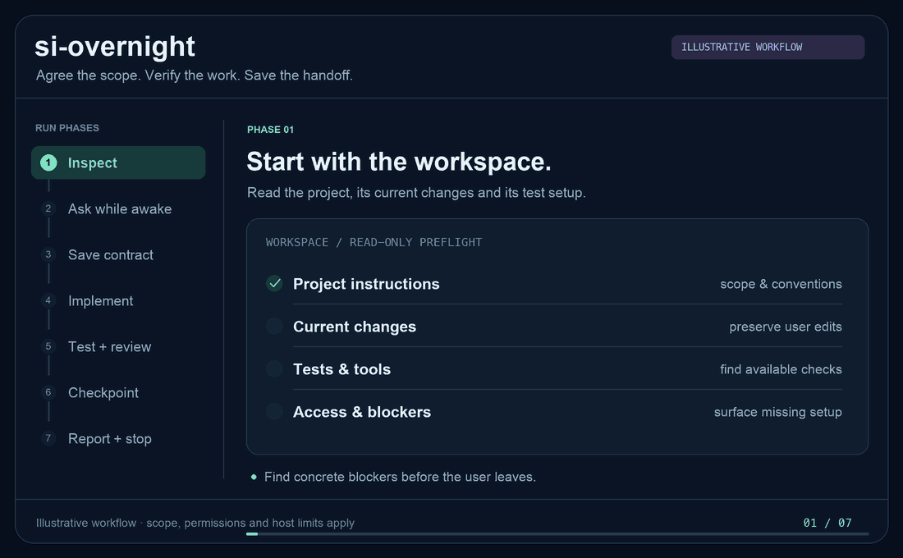

# si-overnight

[English](https://github.com/siguelabs/si/blob/main/README.md) · **Türkçe**

**Uyumadan kararları ver. Agent, belirlediğin işleri uygulasın, test etsin ve sabaha rapor bıraksın.**

`si-overnight`, mevcut coding agent'ına gece çalışma düzeni kazandıran taşınabilir
bir [Agent Skill](https://agentskills.io/). Önce projeyi inceler, sen hâlâ
çevrimiçiyken gerekli soruları toplar; ardından kararlaştırılan kapsamda çalışır.
Codex, Claude Code, Google Antigravity ve pi için kurulum aracı içerir.



*GIF, çalışma adımlarını gösteren bir canlandırmadır. Alt agent kullanımı çalıştırdığın platformun desteğine bağlıdır.*

## Hızlı başlangıç

Node.js **20 veya üzeri** yeterli. Npm CLI'si Python veya ek runtime bağımlılığı
gerektirmez. Bu deponun kök dizininde:

```bash
# Önce kurulum hedeflerini gör.
node bin/si-overnight.mjs --platform all --project /tam/yol/projen --dry-run

# Seçtiğin projeye kur.
node bin/si-overnight.mjs --platform all --project /tam/yol/projen

# Ya da yalnız Codex için kullanıcı genelinde kur.
node bin/si-overnight.mjs --platform codex --scope user
```

`--project` mevcut bir dizin olmalıdır. Kurulumdan sonra hedef projeyi agent'ında
aç ve aşağıdaki platform komutlarından biriyle skill'i çağır.

### Npm üzerinden kurulum

En son yayımlanan sürümü kurmak için:

```bash
npx --yes si-overnight --platform all --project /tam/yol/projen
```

`npm install` tek başına skill'i agent dizinine kopyalamaz; kurulum CLI'sini
ayrıca çalıştırmalısın.

## Hangi platformda nasıl çağırılır?

| Platform | Skill'i çağırma | Proje içindeki kurulum dizini |
| --- | --- | --- |
| Codex | `$si-overnight` veya `/skills` içinden seç | `.agents/skills/si-overnight/` |
| Claude Code | `/si-overnight` | `.claude/skills/si-overnight/` |
| Google Antigravity | `/si-overnight` | `.agents/skills/si-overnight/` |
| pi | `/skill:si-overnight` | `.pi/skills/si-overnight/` |

Kullanıcı genelinde kurulum Codex için `~/.agents/skills/`, Claude Code için
`~/.claude/skills/`, Antigravity için `~/.gemini/config/skills/`, pi için
`~/.pi/agent/skills/` altında aynı `si-overnight/` klasörünü oluşturur.

Diğer Agent Skills uyumlu araçlarda `skills/si-overnight/` klasörünü aracın
belgelediği konuma kopyala. Dosya okuyabilen başka bir agente `SKILL.md` dosyasını
okuyup uygulamasını da söyleyebilirsin. Komutların ve alt agent desteğinin bütün
platformlarda aynı olduğu varsayılmaz.

## Bir gece nasıl ilerler?

### 1. Sen uyumadan önce

Agent önce proje talimatlarını, mevcut değişiklikleri ve test düzenini inceler.
Ardından cevabı projeden veya konuşmadan çıkmayan önemli soruları birlikte sorar:

- Ana hedefler, öncelikleri ve işin bittiğini gösterecek ölçütler.
- Bu gece **Liste** mi, **Keşif** mi kullanılacağı.
- Yedek işler veya keşfe izin verilen alanlar.
- Dokunulmayacak dosyalar, API davranışları ve tasarım kararları.
- Çalışma süresi veya saat dilimiyle birlikte bitiş saati; varsa bilinen bütçe.
- Beklenen testler, gerekli servisler ve erişimler.
- Teslim biçimi ve commit, PR veya deployment gibi işlemlere verilen yetkiler.

Bu gece için cevapladığın soruları yeniden sormaz. Gerekli kararlar tamamlanınca
kısa planı kaydeder ve ayrıca bir başlama onayı turu üretmeden işe geçer.

### 2. Gece modu seçilir

| Mod | Ana işler bitince | Ne zaman durur? |
| --- | --- | --- |
| **Liste / Queue** | Önceden kararlaştırılan yedek işleri yapar. | Onaylı liste bitince veya başka bir durma koşulu oluşunca. |
| **Keşif / Discover** | İzin verilen alanlarda kanıta dayalı iyileştirmeler bulur, önceliklendirir ve tek tek uygular. | Yararlı aday kalmayınca veya başka bir durma koşulu oluşunca. |

**Her yeni gece bu seçim yeniden sorulur.** Önceki gecenin modu kendiliğinden
taşınmaz. Kesilen aynı çalışmaya devam ederken mevcut gece sözleşmesi korunur.

Keşif modu için somut bir sınır örneği: “`src/cart/` ve `tests/cart/` içinde
doğrulanabilir bug fix ve regresyon testi yap; bağımlılık veya ödeme API'si
değiştirme.” Token tüketme isteği tek başına sınırsız proje kapsamı sayılmaz.

### 3. Uygula → test et → incele → kaydet

Agent sıradaki en önemli, engellenmemiş işi seçer; değişikliği yapar, uygun
testleri çalıştırır, sonucu inceler ve ilerlemeyi kaydeder. Anlamlı bir hata
kanıtı varsa düzeltir. Önceden bozuk testleri yeni hatalardan ayırır; çalışmayan
veya çalıştırılamayan kontrolü geçti diye raporlamaz.

Bir iş yeni bir karar ya da erişim gerektiriyorsa onu engeliyle birlikte kaydeder
ve bağımsız, yetkilendirilmiş işlere devam eder. Aynı engelde yeni kanıt olmadan
üç başarısız denemeden sonra başka işe geçer. Sırf token harcamak için aynı
başarılı testleri tekrar tekrar çalıştırmaz.

## Agent'lar nasıl birlikte çalışır?

Ana agent gece planının ve sonucun sahibidir. Platform alt agent destekliyorsa
bağımsız işler için görev dağıtabilir. Örneğin:

| Görev | Sorumluluk |
| --- | --- |
| Ana agent / koordinatör | Öncelikleri, kapsamı, süreyi ve son teslimi yönetir; sonuçları birleştirir. |
| Uygulama görevi | Kendi sorumluluğundaki dosyalarda belirli bir değişikliği yapar. |
| Test veya inceleme görevi | Bağımsız bir işi doğrular, regresyonları veya diff'teki somut sorunları inceler. |

Bu tablo sabit bir agent kadrosu tanımlamaz; görevler ihtiyaca göre seçilir.
Çakışan dosya yazımlarından kaçınılır, bütün çalışanlar aynı kapsam ve süreye
tabidir ve ana agent dönen sonuçları doğrular. Alt agent desteği yoksa aynı akış
tek agent ile yürütülür. Skill bu desteği platforma sonradan eklemez.

## Örnek gece isteği

Codex için:

```text
$si-overnight
Ana hedef: sepetteki doğrulanmış hataları düzelt ve regresyon testlerini ekle.
Bu gece Liste mi Keşif mi kullanacağımızı uyumadan bana sor.
Dokunma: ödeme API kontratları ve mevcut kullanıcı değişiklikleri.
En fazla 6 saat çalış. Teslim: yerel değişiklikler ve sabah raporu.
Gerekli diğer kararları ben çevrimiçiyken birlikte sor.
```

Diğer platformlarda ilk satırı o platformun çağırma komutuyla değiştir.

## Kayıtlar, sabah raporu ve devam etme

Her çalışma hedef projede ayrı bir klasöre yazılır:

```text
.si-overnight/
└── <run-id>/
    ├── run.md       # Kapsam, kararlar, işler, son kontrol ve sıradaki adım
    └── report.md    # Tamamlananlar, test kanıtları, eksikler ve durma nedeni
```

Kayıtlar varsayılan olarak yerelde tutulur; açıkça istemedikçe commit'e alınmaz.
Skill sırf bu dosyaları gizlemek için `.gitignore` veya repo ayarlarını değiştirmez.
Gizli anahtarlar ve hassas komut çıktıları kayıtlara yazılmaz.

Devam örneği:

```text
$si-overnight
.si-overnight/<run-id>/run.md dosyasındaki çalışmaya devam et.
Önce kaydı mevcut dosyalarla karşılaştır. Aynı kapsamı koru.
Eski süre dolduysa bu andan itibaren 2 saatlik yeni pencere kullan.
```

Agent bir komutun kesintiden önce başarıyla bittiğini varsaymaz; mevcut dosyaları,
sonuçları ve diğer kişilerin değişikliklerini kayıtla karşılaştırır.

## Çalışma ne zaman biter?

Onaylı işler bittiğinde, kapsam içinde yararlı keşif kalmadığında, süre veya
gözlemlenebilir kota sınırı dolduğunda, bütün kalan işler engellendiğinde ya da sen
durmasını istediğinde çalışmayı sonlandırır. Ölçülemeyen kalan kotayı tahmin diye
sunmaz.

**Skill bir süreç yöneticisi değildir.** Bilgisayarı uyanık tutmaz, kapanan agent'ı
yeniden başlatmaz, yeni model turları oluşturmaz veya kota yenilemez. Yerel
makine/oturum veya gerçekten uzakta çalışan ortam kullanılabilir kalmalıdır.
Ani kesintide son kayıttan devam edilebilir; durmuş süreç sonradan rapor yazamaz.
Host'un uzun çalışma özelliği ayrıca kullanılabilir; bu skill kendiliğinden bir
Goal, zamanlanmış görev veya arka plan runner'ı oluşturmaz.

## CLI seçenekleri ve Python alternatifi

| Seçenek | Değer / davranış |
| --- | --- |
| `--platform` | `codex`, `claude`, `antigravity`, `pi` veya `all`; zorunlu. |
| `--scope` | `project` (varsayılan) veya `user`. |
| `--project` | Mevcut proje dizini; varsayılan geçerli dizin. Kullanıcı kapsamını değiştirmez. |
| `--dry-run` | Hedefleri gösterir, dosya yazmaz. |
| `--help` | Yardımı gösterir. |

Npm CLI'sinde birden fazla platform için bayrağı tekrarla:

```bash
node bin/si-overnight.mjs --platform claude --platform pi --dry-run
```

Kurucu farklı bir mevcut skill'in üzerine yazmaz; içerik aynıysa dosyaları
değiştirmez. Seçtiğin kökün altındaki kurulum yollarında sembolik bağlantılar
reddedilir. Açıkça seçilen kökün kendisi bir dizin takma adı olabilir. Güncellemede
mevcut kurulumu inceleyip taşıdıktan sonra yeniden kur. Kurulum agent izinlerini
değiştirmez veya çalışmayı başlatmaz.

Kaynak kod deposunda Python 3 alternatifi de bulunur:

```bash
python3 scripts/install.py --platform all --project /tam/yol/projen
```

## Geliştirme ve sürüm yayımlama

```bash
npm test
python3 -m unittest discover -s tests -v
node .github/scripts/pack-smoke.mjs /tmp/si-overnight-package-check
```

Son komutun çıktı dizini boş olmalıdır. Gerçek `.tgz` dosyasını boş npm cache'iyle
çevrimdışı kurar, CLI'yi ve skill dosyalarının byte eşitliğini kontrol eder.

README'deki canlandırmayı yeniden oluşturmak için `python3 scripts/render_workflow.py`
çalıştır. Bu geliştirme aracı Pillow gerektirir; npm kurucusunun runtime bağımlılığı
değildir.

CI her branch push'unda ve PR'da Node.js 20/24 ile testleri çalıştırır; paket ve
SHA-256 özeti `npm-package` artifact'i olarak hazırlanır. Sürümle eşleşen
`vMAJOR.MINOR.PATCH` etiketi, testler geçtikten sonra aynı paketi npm'e yayımlar.
Ön sürüm etiketleri mevcut release akışında desteklenmez.

İlk npm kaydı için hesabın yayın yetkisi gerekir. Staged bir sürüm varsa npm
profilindeki **Staged Packages** üzerinden inceleyip 2FA ile onayla. Yayımlanmış
aynı isim/sürüm yeniden kullanılamaz. [Staged publishing belgesi](https://docs.npmjs.com/staged-publishing/).

Otomatik yayın için paket **Settings → Trusted publishing → GitHub Actions**
ayarında owner `siguelabs`, repo `si`, workflow `release.yml`, environment boş ve
**Allow npm publish** açık olmalıdır. Bu OIDC akışı `NPM_TOKEN` secret'ı
gerektirmez. Yeni bağlantının ilk yayını iki gün içinde yapılmalıdır. Provenance
için kaynak repo public ve `repository.url` aynı GitHub deposuna bağlı olmalıdır.
Yayın işi Node.js 24 ve npm ≥11.5.1 kullanır/kontrol eder.
[Trusted publishing belgesi](https://docs.npmjs.com/trusted-publishers/).

Kod yapısı: `skills/si-overnight/` ortak çalışma talimatlarını, `bin/` ve `lib/`
Node kurucusunu, `scripts/install.py` Python alternatifini, `tests/` kontrolleri,
`.github/` CI ve release akışlarını içerir. Platformlara ilişkin resmi kaynaklar
[uyumluluk notlarında](skills/si-overnight/references/platforms.md) bulunur.

Katkı yaparken kurucu değişikliklerini ilgili testlerle doğrula; çalışma akışı
değişikliklerinde iki dildeki README'yi birlikte güncelle. Paket şu anda
**`UNLICENSED`** olarak tanımlıdır; açık kaynak kullanım lisansı verilmemiştir.
