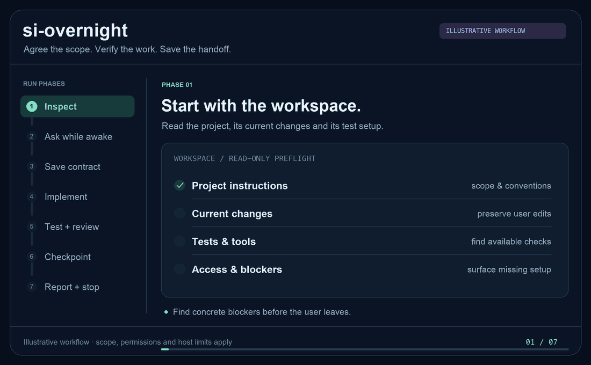

# si-overnight

[English](https://github.com/siguelabs/si/blob/main/README.md) · **Türkçe**

Yatmadan önce kod yazan yapay zekâ aracınla yapılacak işleri belirle.
`si-overnight`, sen uyurken aracın proje üzerinde çalışmasına ve sabaha bir rapor bırakmasına yardımcı olur.

## Nasıl kurulur?

Önce Node.js 20 veya üzerini kur. [Node.js’i indir](https://nodejs.org/en/download)

Terminali aç ve şu komutu çalıştır.

```bash
npx si-overnight
```

npm paketi kurmak için onay isterse Enter’a bas.

1. Kullandığın aracı seç. Hepsine kurmak için **All** seçeneğini kullan.
2. Tüm projelerinde kullanmak için **All projects**, yalnızca terminalde bulunduğun projeye kurmak için **Current project** seç.
3. Çalışılacak projeyi yapay zekâ aracında aç ve aşağıdaki komutu aracın **sohbetine** yaz.

| Araç | Sohbette kullanacağın komut |
| --- | --- |
| Codex | `$si-overnight` veya `/skills` menüsünden `si-overnight` |
| Claude Code | `/si-overnight` |
| Google Antigravity | `/si-overnight` |
| pi | `/skill:si-overnight` |

Örneğin Codex’te şöyle başlayabilirsin.

```text
$si-overnight
Kaydet düğmesine iki kez basınca oluşan çift kayıt hatasını düzelt.
Gitmeden önce gerekli soruları sor. En fazla iki saat çalış.
```

## Gece neler olur?

Araç önce projeyi inceler. Sen yatmadan eksik kararları sorar. Hangi işin önce
yapılacağını, nerelere dokunabileceğini ve ne kadar çalışacağını birlikte belirlersiniz.

Ana işler bitince ne yapacağını her yeni gece için seçersin.

- **Liste (Queue)** ile araç önceden belirlediğin yedek işleri de yapar ve liste bitince durur.
- **Keşif (Discover)** ile araç izin verdiğin alanlarda iyileştirmeler bulup uygular.

Araç değişiklikleri yapar, testleri çalıştırır ve ilerlemesini kaydeder.
Kullandığın araç destekliyorsa birbirinden bağımsız birkaç işi aynı anda yürütebilir.



Kendi bilgisayarında çalışıyorsan gece boyunca bilgisayarın uyanık, yapay zekâ aracın açık kalmalı.

## Raporu nerede bulurum?

Projedeki `.si-overnight/<run-id>/report.md` dosyasında tamamlanan işleri, test
sonuçlarını ve varsa kalan işleri görebilirsin. Çalışma yarıda kalırsa araçtan
aynı klasördeki `run.md` dosyasını okuyup devam etmesini iste.

[Platformlara göre kurulum yerleri](https://github.com/siguelabs/si/blob/main/skills/si-overnight/references/platforms.md) · [Geliştirici rehberi](https://github.com/siguelabs/si/blob/main/docs/development.md)
